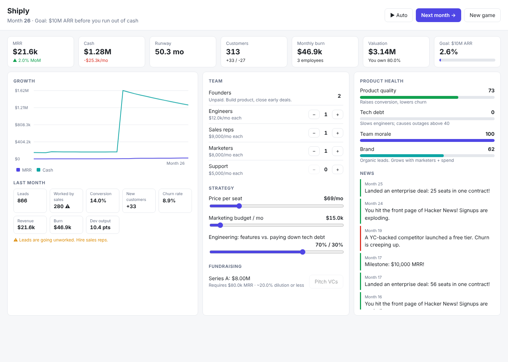

# SaaS Simulator

Grow a two-founder SaaS startup from a garage to **$10M ARR** before the cash runs out.



## Run it

```sh
npm start        # http://localhost:3000  (set PORT to change)
npm test         # engine tests
```

No dependencies. Needs Node 18+.

## How to play

Each turn is one month. Press **Next month** (or Space), or **Auto** to let time run.

- **Team**: hire engineers (build product), sales reps (work leads), marketers (build brand) and support (keep churn down as you scale). Every hire costs salary + $3k recruiting; layoffs cost a month of severance and hurt morale.
- **Price**: higher prices mean more revenue per customer, but lower conversion and higher churn.
- **Marketing budget**: buys leads. Leads nobody works are wasted, so sales capacity matters.
- **Engineering focus**: shipping features raises product quality but piles up tech debt. Above 40 debt, outages become likely.
- **Fundraising**: Seed ($4k MRR), Series A ($80k MRR), Series B ($400k MRR). Raising dilutes you, and the terms depend on your recent growth.
- **Random events**: Hacker News launches, outages, competitors, enterprise deals, downturns, poaching.

You **win** at $10M ARR (acquisition; your payout is valuation × your equity). You **lose** when cash goes negative. The game autosaves to localStorage.

## Code

- `public/engine.js`: pure, seeded simulation (no DOM), used by both the UI and the tests
- `public/ui.js`, `index.html`, `style.css`: the dashboard
- `server.js`: tiny static file server
